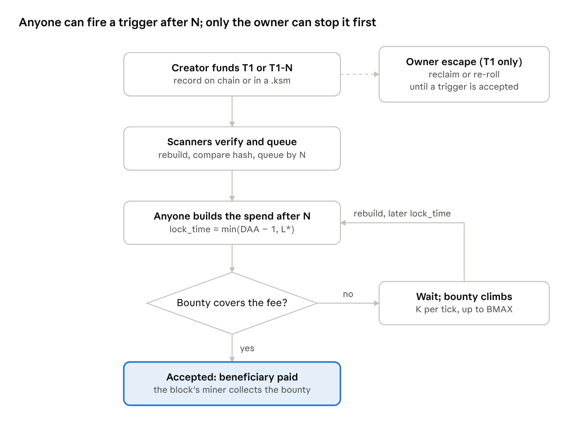

# Covenant Activation Through Miner Action (CATMA): v0.1 Specification

Nov 25, 2026 · Oz Steinmetz, Kaspero Labs

## Overview

CATMA is a self-executing layer for Kaspa L1 covenants, added with no consensus change. A covenant that would otherwise wait for someone to trigger it by hand carries a bounty instead. Once its DAA score arrives, anyone may spend it, but only into the payout fixed at creation.

The capped leftover is the transaction fee, so the miner whose block includes the spend is paid for executing it. Every execution is fee income for miners that comes from Kaspa usage, on top of block rewards. Creators get execution with no server and no keeper key.

For example, a tenant locks 100 KAS for the landlord at the DAA score of the 1st of the month. At that score a miner executes the payment and keeps the bounty as its fee.

Goals:

- Self-execution: covenants that would otherwise need a manual trigger execute once their condition is met, paid for by their own bounty.
- Correctness from L1: a trigger fires only at or after its DAA score, and only into its committed output.
- Liveness from incentives: the fee pays the miner who includes the trigger, and anyone can broadcast it at no cost, the beneficiary included.
- Escalation: a bounty that climbs until it clears at any fee level, up to a cap.
- One audited template family that any scanner recognizes from on-chain data alone.
- Durability: records outlive pruning through a self-funded beacon, so a creator can deploy a year ahead and shut down.
- Oracle-ready: conditions with deadlines plug in later as new templates under the same record format.

Non-goals for v0.1:

- Oracle conditions. The shape is reserved, not implemented.
- Stateful templates (recurring, heartbeat). v0.1 covers them as recipes on T1.
- Consensus changes. CATMA uses the Toccata opcode set as it is in rusty-kaspa master.
- Randomness-dependent outcomes such as lotteries. The block producer chooses the block and can grind block-derived randomness.

## Roles

Only the creator ever signs anything. Broadcasting and mining are separate roles: anyone can broadcast, and whoever mines the accepting block is paid.

| Role | What it does | Key needed | Paid |
| --- | --- | --- | --- |
| Creator | Funds the covenant, picks a template and params, publishes the record | Funding key; owner key for T1's escape | No |
| Trigger covenant | P2SH UTXO that enforces the time, the committed output and the bounty cap | None | No |
| Broadcaster | Builds the trigger spend from public data and submits it: the beneficiary, the creator's bot, the Studio, Kasla, a pool | None | No; the fee goes to the miner |
| Miner or pool | Includes the spend; its block's coinbase collects the fee | Its normal coinbase address | Yes, the bounty |
| Beneficiary | Receives the committed output | None | The payout |
| Beacon | A covenant that republishes the creator's records every period, paying the fee from its own balance | None | No; the fee goes to the miner |

The trigger spend is not someone else's signed transaction being relayed. The trigger branch has no signature check. Anyone rebuilds the spend from the funding outpoint, the template and the params, chooses its lock\_time, and leaves the bounty as the fee.

## Lifecycle



A trigger runs from funding to payout with nobody online on the creator's side. If the bounty doesn't yet cover the fee, broadcasters wait and rebuild with a later lock\_time. T1's owner can step in at any point until a trigger is accepted; T1-N has no escape.

## Template identity and the record

A CATMA redeem script is a param header followed by the template's code. A P2SH output shows only the Blake2b-256 hash of that script, so a record carries the header and names the code by its template ID. Scanners rebuild the script, hash it and compare.

### Template ID

The template ID is the KCC-1 template hash with an empty prefix, the same rule the Studio's kcc1.js and verifier already use:

```latex
\text{template\_id} = \mathrm{BLAKE3}\big(\mathrm{le64}(0) \,\|\, \mathrm{le64}(\mathrm{len}(\text{code})) \,\|\, \text{code}\big)
```

The redeem script is header followed by code. It matches the output when Blake2b-256 of that script equals the hash inside the output's `aa20<hash>87`.

Template IDs are immutable. A bug fix is a new ID, never an edit. The registry (the Studio's covenant registry) lists each audited ID with its code, its header fields, its condition and its audit trail. Scanners act only on IDs they have reviewed.

### Header encoding

Each param is exactly one explicit push, in the order the template lists them:

- Integers: `OP_DATA_8` and 8 bytes little-endian, value from 0 to 2^63 − 1.
- Public keys: `OP_DATA_32` and 32 bytes.
- Script public keys: `OP_DATA_36` or `OP_DATA_37` and the bytes as `OpTxOutputSpk` pushes them: 2-byte version, then the script.

A header that doesn't parse exactly into the template's field list is ignored, even if the hash matches.

### Record

| Field | Size | Meaning |
| --- | --- | --- |
| magic | 5 bytes | ASCII `CATMA` |
| version | 1 byte | `0x00` |
| count | 1 byte | Number of records that follow |
| kind | 1 byte | `0x00` inline: the covenant is an output of this tx. `0x01` detached: the outpoint is given |
| txid | 32 bytes | Detached records only |
| output\_index | 2 bytes, u16 LE | The covenant output |
| template\_id | 32 bytes | As defined above |
| header\_len | 2 bytes, u16 LE | Length of the header |
| header | variable | The exact header bytes |

The last six fields repeat per record, so one funding tx can create a ladder of triggers. v0's `condition_type` is dropped; the registry entry for the template says what the condition is.

### Channels

Records are hints, never trusted on their own, so the channel doesn't matter:

- **Inline:** the funding tx's payload. Best when the Studio builds the funding tx.
- **Detached:** any later tx's payload, sent by anyone, the beneficiary included. This covers wallets that can't attach a payload, such as a Kasware `sendKaspa` funding.
- **Beacon:** a covenant that republishes the records every period (see Record durability). This is the channel that survives pruning.
- **Off-chain:** the same record bytes in a `.ksm` file or served by an API.

Ordinary nodes prune transaction data after about 30 hours. Inline and detached records are therefore visible on chain for about a day; after that, only scanners that indexed them still know them. A covenant whose N is more than a day away should be carried by a beacon.

A T1 inline record is about 150 bytes. For the relay fee, payload bytes cost about 2 grams each: transient mass counts 4 grams per byte and is weighted at half against compute mass. A record therefore costs about 300 grams, or roughly 0.0003 KAS. Spam costs its sender the same.

## Templates T1 and T1-N: TIME\_AFTER, one-shot

T1 pays the whole coin, minus a bounty that grows with time, to one beneficiary at or after DAA score N. T1 is revocable: the owner can take the coin back until a trigger is accepted, and after N the two race. T1-N is the same template with no owner branch, for payments the beneficiary must be able to count on.

### Params, in header order

| Param | Encoding | Meaning | Creation rule |
| --- | --- | --- | --- |
| OWNER\_PUBKEY | 32 bytes | Schnorr key for the escape | T1 only |
| BENEFICIARY\_SPK | 36 or 37 bytes | The committed output's script, version included | P2PK, P2PK-ECDSA or P2SH, or the trigger won't relay |
| BMAX | 8-byte int, sompi | Bounty cap | At least B0; leave a payout above about 0.2 KAS |
| B0 | 8-byte int, sompi | Bounty at N | At least 3 times the relay fee for the trigger's mass |
| K | 8-byte int, sompi per DAA tick | Escalation rate | 0 or more |
| N | 8-byte int, DAA score | Release score | Above 0 and below 500,000,000,000, so it's a DAA score, not a time |

The script checks none of the creation rules. The creator's UI checks them, and scanners skip covenants that break them.

### Trigger branch rules

Let i be this input's index.

1. `tx.lock_time` is at least N, and this input's sequence is below `u64::MAX`, so CLTV applies.
2. Output i pays BENEFICIARY\_SPK.
3. Output i is at least input i's amount minus the bounty, where bounty = min(B0 + K × (lock\_time − N), BMAX).

There is no input or output count rule. Each CATMA input checks only the output at its own index, the SIGHASH\_SINGLE idiom. Several triggers batch into one transaction, and an extra output can be paid only from the bounties and any inputs the triggerer adds. No covenant can lose more than its own bounty.

### Owner branch (T1 only)

A valid OWNER\_PUBKEY signature; outputs unrestricted. The owner can also use it to re-roll a trigger into a new one (see Recipes).

### Code

The header leaves the stack as OWNER\_PUBKEY, BENEFICIARY\_SPK, BMAX, B0, K, N, with N on top and the selector below all six. To be checked on the engine before audit:

```
6 OpRoll                                   // selector up from under the six params
OpIf                                       // selector 1: trigger
  OpDup OpCheckLockTimeVerify              // lock_time >= N; CLTV pops its copy
  OpTxLockTime OpSwap OpSub                // elapsed = lock_time - N
  OpMul OpAdd OpMin                        // bounty = min(B0 + K * elapsed, BMAX)
  OpTxInputIndex OpTxInputAmount OpSwap OpSub            // floor = input i - bounty
  OpTxInputIndex OpTxOutputAmount OpSwap
  OpGreaterThanOrEqual OpVerify            // output i >= floor
  OpTxInputIndex OpTxOutputSpk OpEqual     // output i pays BENEFICIARY_SPK
  OpNip                                    // drop OWNER_PUBKEY, keep the result
OpElse                                     // selector 0: owner escape
  Op2Drop Op2Drop OpDrop                   // drop N, K, B0, BMAX, BENEFICIARY_SPK
  OpCheckSig                               // signature against OWNER_PUBKEY
OpEndIf
```

T1-N's header has no OWNER\_PUBKEY. Its code is the trigger branch alone, with no `6 OpRoll`, `OpIf`, `OpNip` or escape. Both branches end with exactly one item on the stack, as Kaspa's clean-stack rule requires.

### Signature scripts

| Spend | Signature script | sigOpCount |
| --- | --- | --- |
| T1 trigger | `OP_1`, then the redeem script | 0 |
| T1 owner escape | the 65-byte signature, `OP_0`, then the redeem script | 1 |
| T1-N trigger | the redeem script alone | 0 |

The selector is `OP_1` or `OP_0`, never another encoding. A trigger input with sigOpCount 0 is lighter in mass.

## Bounty

The bounty is the fee, and competition, not the creator's generosity, sets what is actually paid. A creator should set B0 near cost and let K and BMAX carry the trigger through congestion.

### The fee is the bounty

- **The rule:** output i gets input i minus the bounty, and the difference is the transaction fee. The miner whose block gets the spend accepted collects it. There is nothing to front-run, because no output belongs to the triggerer.
- **Why not an address for the submitter:** an extra output paying the submitter is allowed but never promised. No signature ties it to the submitter, so any miner can drop or swap it, and rival bots can outbid it by replacement. Either way the bounty ends up with miners, so the standard pays them directly.

### Escalation

The mempool accepts a transaction only when its lock\_time is below the virtual DAA score, and a block only when it's below that block's DAA score. So `OpTxLockTime` is a lower bound on "now" that the spender chooses. The spender wants it as high as possible, because the bounty grows with it. That makes the trigger a Dutch auction that finds its own price at any fee level.

Once a trigger is broadcast, every pool's template can include it, and the first block accepted wins, so the bounty lands with miners in proportion to hashrate. A pool's own scanner earns only its hashrate share, unless the pool keeps the spend out of the public mempool, which takes a node change. Either way the trigger fires.

### Sizing

The relay floor is 100 sompi per gram of max(compute mass, transient mass weighted at half). A T1 trigger is estimated at 1,000 to 3,000 grams, so about 0.001 to 0.003 KAS (to be measured on testnet). At about 10 DAA ticks per second, K sompi per tick adds K × 36,000 sompi an hour. BMAX divided by the trigger's mass is the highest fee rate the trigger can ever clear.

| Preset | B0 | K | Climb | BMAX | Cap reached after N | Clears up to, at 2,000 g |
| --- | --- | --- | --- | --- | --- | --- |
| Everyday | 0.01 KAS | 250 sompi/tick | 0.09 KAS/h | 1 KAS | about 11 h | 500 × floor |
| Congestion-proof | 0.01 KAS | 1,000 sompi/tick | 0.36 KAS/h | 5 KAS | about 14 h | 2,500 × floor |

With a broadcaster watching at N and normal fees, the bounty actually paid is close to B0. A creator who wants to tip miners on purpose raises B0 and knows it's a gift.

### Lock\_time cap

Above L\* = N + ceil((BMAX − B0) / K) the bounty stops growing (L\* = N when K is 0). Far above it, K × elapsed can overflow i64 and fail the script. Builders therefore use lock\_time = min(virtual DAA − 1, L\*). The spender picks lock\_time, so overflow can never lock the coin.

## Broadcaster and scanner behavior

A scanner is a small keyless service beside a kaspad node. For a pool it feeds the pool's own block templates, which is the native CATMA path. The beneficiary's wallet, the Studio, Kasla or a creator's bot can run one too; they earn nothing, but they make sure the trigger reaches the mempool. The Studio should run a public one from day one, so CATMA works before any pool adopts it.

1. **Index.** On startup, read every block the node still holds (about the last 30 hours), so the latest republish of every live beacon is found. Then follow accepted transactions through the node's virtual-chain notifications and parse payloads that start with `CATMA`. Accept off-chain records too. For each record, rebuild header and code from the registry, hash it and compare it with the output's script. Check the creation rules. Store the outpoint, template, params, N and L\*.
2. **Track.** Drop an entry as soon as its outpoint is spent in an accepted transaction, using UTXO-change notifications. Keep the rest in a queue ordered by N.
3. **Wait.** An entry is eligible once the virtual DAA score passes N.
4. **Build.** Set lock\_time L = min(virtual DAA − 1, L\*). Each CATMA input gets sequence 0, sigOpCount 0 and the signature script from the T1 table. Output i is the beneficiary, worth input i minus bounty(L). Eligible triggers can share one transaction, each paired by index.
5. **Check profit.** Submit only if the total bounty minus the relay fee for the transaction's mass clears the scanner's threshold. A beneficiary's threshold is zero. Otherwise wait; the bounty keeps climbing.
6. **Submit.** Send to the scanner's own node. If the mempool already holds a spend of the same outpoint, that is a pending trigger, not a spend. Rebuild with the current L and submit it as a replacement (`submitTransactionReplacement`) when it pays more. Drop the entry only at step 2.
7. **Refresh.** A trigger still pending after fees rose is rebuilt with a fresh L and replaced the same way.

A scanner also republishes beacons: when a beacon's coin is P old, it builds the republish spend described below and submits it the same way.

A scanner holds no funds and signs nothing, so nothing on it can be stolen. A compromised scanner can at worst fire triggers that were already eligible, into their committed outputs.

## Record durability: the beacon

A beacon keeps a creator's records on chain for as long as it is funded, so every covenant can still be found and fired after the creator is gone. It is a covenant that anyone may spend once every period P, but only to republish the committed records in the payload and pay itself back, minus a capped fee for the miner.

### Why a covenant can't simply hold the list

The UTXO set keeps a P2SH coin only as the 32-byte hash of its script. The script and any data in it appear only in the transaction that spends the coin, and nodes prune that after about 30 hours. A covenant can commit to records, but it can't make the chain store them. The beacon solves this by making the chain see them again before they are pruned, every period, paid for by the beacon's own balance.

### Template B1: beacon

| Param | Encoding | Meaning | Creation rule |
| --- | --- | --- | --- |
| RETURN\_SPK | 36 or 37 bytes | Where the leftover goes when the beacon is retired | Standard class |
| RECORDS\_HASH | 32 bytes | Blake2b-256 of the exact records payload | The payload holds detached records only |
| FEE\_CAP | 8-byte int, sompi | Most a republish may pay as fee | About 2 times the relay fee for the republish's mass |
| P | 8-byte int, DAA ticks | Least age of the coin between republishes | Well under the pruning window: 720,000 (about 20 hours) leaves 10 hours of margin |
| END | 8-byte int, DAA score | Earliest score at which the beacon may be retired | After the last N it carries, plus a margin |

**Republish branch (selector 1):**

1. The coin is at least P DAA old (CSV), so it can republish at most once per period.
2. Output i continues this same beacon: its script equals input i's script.
3. Output i is at least input i's amount minus FEE\_CAP.
4. The transaction's payload hashes to RECORDS\_HASH.

**Retire branch (selector 0):**

1. `tx.lock_time` is at least END (CLTV).
2. Output i pays RETURN\_SPK, at least input i's amount minus FEE\_CAP.

Neither branch has a signature check. The beacon's script never changes, so it needs no state proof.

```
5 OpRoll                                   // selector up from under the five params
OpIf                                       // selector 1: republish
  OpDrop                                   // drop END
  OpCheckSequenceVerify                    // coin is at least P old; CSV pops P
  OpTxInputIndex OpTxOutputAmount
  OpTxInputIndex OpTxInputAmount
  OpRot OpSub                              // floor = input i - FEE_CAP
  OpGreaterThanOrEqual OpVerify            // output i >= floor
  0 OpTxPayloadLen OpTxPayloadSubstr OpBlake2b
  OpEqualVerify                            // payload hashes to RECORDS_HASH
  OpDrop                                   // drop RETURN_SPK
  OpTxInputIndex OpTxOutputSpk
  OpTxInputIndex OpTxInputSpk OpEqual      // output i continues this beacon
OpElse                                     // selector 0: retire
  OpCheckLockTimeVerify                    // lock_time >= END; CLTV pops END
  OpDrop OpNip                             // drop P and RECORDS_HASH
  OpTxInputIndex OpTxOutputAmount
  OpTxInputIndex OpTxInputAmount
  OpRot OpSub                              // floor = input i - FEE_CAP
  OpGreaterThanOrEqual OpVerify            // output i >= floor
  OpTxInputIndex OpTxOutputSpk OpEqual     // output i pays RETURN_SPK
OpEndIf
```

The header leaves the stack as RETURN\_SPK, RECORDS\_HASH, FEE\_CAP, P, END, with END on top. To be checked on the engine before audit.

| Spend | Signature script | Input sequence | lock\_time | sigOpCount |
| --- | --- | --- | --- | --- |
| Republish | `OP_1`, then the redeem script | P | 0 | 0 |
| Retire | `OP_0`, then the redeem script | 0 | at least END | 0 |

### Life of a beacon

1. **Create.** The creator's funding transaction pays the beacon coin. Its payload is one CATMA blob holding the beacon's own inline record plus the detached records it will carry.
2. **Republish.** Every period, any scanner spends the beacon into itself with the records blob as payload. The miner keeps up to FEE\_CAP. The spend reveals the beacon's script, so from the first republish on the beacon describes itself.
3. **Retire.** From END on, anyone may pay the leftover to RETURN\_SPK. Until someone does, republishing simply continues.

A scanner starting up at any time finds the latest republish within the last 30 hours of blocks, and with it every record and the beacon itself. The creator needs no server, repo or API.

### One beacon per creator

Each creator, or each batch, deploys its own beacon; "registering" means deploying one. A single shared beacon would need a state change for every registration, its payload would grow without limit, and anyone could spam it to raise every other registrant's cost.

### Cost

These are estimates, to be measured on testnet. A republish costs about 2 grams per byte for the relay fee, at 100 sompi per gram. A detached T1 record is about 176 bytes. The transaction limit (1,000,000 grams of transient mass) would allow about 1,400 records, but a beacon should stay near 140 records (about 25 KB) so one republish takes only a small slice of a block.

| Records | Payload | Relay floor per republish | Per year at P = 20 h, FEE\_CAP = 2 × floor |
| --- | --- | --- | --- |
| 10 | about 1.8 KB | about 0.004 KAS | up to about 4 KAS |
| 100 | about 17.6 KB | about 0.036 KAS | up to about 31 KAS |

All of it goes to miners. A flat FEE\_CAP means a scanner that is also a miner will take the full cap, so FEE\_CAP should sit close to cost. An escalating republish fee, measured from the coin's DAA score with `OpTxInputDaaScore`, is a possible B2.

## Recipes on T1

The uses v0 gave to T3 and T4 are built from T1 coins, so v0.1 ships one template family and no state proofs.

| Use | Built from | How |
| --- | --- | --- |
| Delayed payment or gift | One T1 or T1-N | Release at N to the recipient |
| Paycheck, rent, allowance | A ladder of T1 | k records in one funding tx at N, N + P, N + 2P. Each rung is its own coin; the owner cancels the rest with the escape |
| Vesting | A ladder of T1-N | The same ladder, with no take-back |
| Dead man's switch | One T1 to the heir | Before N, the owner re-rolls: spends with the escape into a new T1 at a later N and sends a new record. One signed tx per heartbeat |
| Staged heirs | A ladder of T1 | Different beneficiaries at different N, each re-rolled together |
| Chained release | T1 into a covenant | BENEFICIARY\_SPK is another covenant's P2SH: a vault, an escrow, another CATMA |

Storage mass limits how many small rungs fit in one funding tx. Larger rungs or several funding txs avoid it; the Studio should measure before offering a ladder UI.

### When a new template is worth it

These recipes trust the owner key. A stolen key takes everything through T1's escape, and a heartbeat keeps that key in use. Later templates earn their place by restricting the owner:

- **Restricted escape (T4 style):** the owner branch may only push N forward, or may only pay out after a delay. This needs a next-state proof. Use the KCC-20 pattern, both covenant ID lineage and the KCC-1 template check (`validateOutputState`), not one or the other.
- **CATMA branch inside other templates:** an escrow or HTLC whose timeout refund is a keyless CATMA branch, so the refund fires with nobody online.
- **Stateful recurring:** only if ladders prove too heavy in storage mass.

## Deadlines and oracles

Kaspa script can enforce "not before" but never "not after", so a pure time window is impossible and T2 moves under oracles.

### Why a window can't be enforced by time

CLTV checks that `tx.lock_time` is at least a value, and the spender chooses lock\_time. A spender at any score after M can still pick a lock\_time between N and M, and that spend stays valid forever. A rule like "fire only before M" therefore has no effect. What script can do is open a second path at M, such as a refund, so the trigger and the refund race from then on. T1's owner escape after N is the same race.

### Deadlines through signed timestamps

A real deadline needs a time the spender can't choose: a score inside a message someone else signed. That is what ORACLE\_EVENT provides, so time windows belong there.

**ORACLE\_EVENT (reserved).**

- **Params:** oracle pubkey, feed ID, predicate (comparison and threshold), and optionally a window \[N, M\].
- **Witness:** an oracle-signed message of feed ID, value, event DAA score and expiry, checked with `checkMsgSig` (BIP340 over a 32-byte Blake2b-256 digest, x-only key).
- **Window:** the script checks N ≤ event score ≤ M from the signed message, so "the event happened in time" is enforceable.
- **Freshness:** comes from the message, either event semantics ("crossed X at score d") or a signed expiry. It must never come from lock\_time, or a spender could choose a low lock\_time and replay yesterday's price.

The registry gives each oracle template its own condition entry; the record format doesn't change.

## Threat model and invariants

The trigger branch can do one thing, at one time, into one place, and can lose at most its own bounty. Most of the remaining risk lives in the template's correctness and in T1's owner key.

| Threat | Defense | What remains |
| --- | --- | --- |
| Early trigger | CLTV against N; a tx with lock\_time at or above the current DAA score is not final | Nothing |
| Funds redirected | Output i must match BENEFICIARY\_SPK and the amount floor | Nothing, if the template is correct |
| Over-taking by batching or extra outputs | Each input checks only its own output | Extra outputs can spend only bounties and the triggerer's own inputs |
| Low lock\_time to fire cheaply | A lower lock\_time only lowers the triggerer's own bounty | For oracle types: stale replay, handled by event or expiry semantics |
| Arithmetic overflow | The spender chooses lock\_time; builders cap it at L\* | Nothing |
| Fake or garbage records | Hash check; records are only hints | Scanner CPU, paid for in the spammer's mass fees |
| Front-running | Fee mode leaves nothing to steal | An output paying the submitter can be swapped, so it's never promised |
| Trigger parked in the mempool | Replace by fee with a later lock\_time | A scanner that drops on conflict misses it |
| Never triggered | The beneficiary can broadcast for free; escalation; BMAX; T1's escape | BMAX below a long fee spike delays T1-N until fees fall. Funds wait, they aren't lost |
| Beneficiary surprised by a revocation | T1 is labeled revocable until paid; T1-N exists | A UI that hides the label |
| Owner key stolen (T1) | None: the escape pays anywhere | Use T1-N, or a restricted-escape template later |
| Template bug | Immutable audited IDs; red-team with kaspa-redteam before the registry | Systemic: every covenant on that ID at once |
| Parallel blocks include the same spend | The DAG accepts one; the other copy is ignored | Nothing |
| DAA score vs wall clock | Release is defined in DAA score | Wall-clock dates are estimates; show them as estimates |
| Record pruned before N | A beacon republishes it every P, inside the 30-hour window | Nothing while the beacon is funded |
| Beacon runs dry | Fund it to past the last N it carries; FEE\_CAP near cost | Scanners that indexed the records still fire them; new scanners can't find them |
| Beacon payload swapped or trimmed | The republish branch checks the payload's hash | Nothing |
| Beacon drained by fees | At most FEE\_CAP per spend, at most one spend per P | Nothing beyond the budgeted fees |
| Beacon late in congestion | FEE\_CAP above the usual floor; P well under 30 hours | A gap in on-chain visibility; scanners already running are unaffected |
| Expecting a deadline | Script can't say "not after" | Use an oracle template with a signed event score |

### Invariants every audit must prove

1. A CATMA input's value leaves only into output i, matching BENEFICIARY\_SPK, worth at least input i minus the bounty, or through the owner's signature (T1).
2. The trigger branch fails whenever lock\_time is below N, so no trigger is accepted before DAA score N.
3. The value a trigger takes from any one covenant never exceeds BMAX.
4. Validity depends only on on-chain data, never on the record or the scanner.
5. For every DAA score from N on, there is a lock\_time that makes the trigger valid without overflow.
6. A beacon's value leaves only into its own continuation or, from END on, to RETURN\_SPK, and each spend pays at most FEE\_CAP.
7. A beacon republish succeeds only with the committed records as the payload, and at most once per P.

## Checked against rusty-kaspa master

Read at commit 68bd2e9 (Nov 23, 2026). These answer v0's open questions by reading the code; testnet still has to confirm them in practice.

| Question | Finding | Source |
| --- | --- | --- |
| Opcodes available | `OpCheckLockTimeVerify` (0xb0), `OpTxLockTime` (0xb5), `OpTxInputIndex`, `OpTxInputAmount`, `OpTxOutputAmount`, `OpTxOutputSpk`, `OpMin` all present; no fork flag gates them. Toccata is live on mainnet since June 30, 2026 | [opcodes/mod.rs](https://github.com/kaspanet/rusty-kaspa/blob/68bd2e91cddbdcdca5e59357344c7e26f2d6d97b/crypto/txscript/src/opcodes/mod.rs) |
| CLTV semantics | Pops its operand; requires the same lock type, operand ≤ tx lock\_time, and this input's sequence below `u64::MAX` | [opcodes/mod.rs](https://github.com/kaspanet/rusty-kaspa/blob/68bd2e91cddbdcdca5e59357344c7e26f2d6d97b/crypto/txscript/src/opcodes/mod.rs) |
| Arithmetic limits | i64 with checked add, sub and mul; overflow fails the script | [opcodes/mod.rs](https://github.com/kaspanet/rusty-kaspa/blob/68bd2e91cddbdcdca5e59357344c7e26f2d6d97b/crypto/txscript/src/opcodes/mod.rs) |
| Clean stack | Exactly one item must remain | [lib.rs](https://github.com/kaspanet/rusty-kaspa/blob/68bd2e91cddbdcdca5e59357344c7e26f2d6d97b/crypto/txscript/src/lib.rs) |
| Lock\_time margin | Final when lock\_time < the virtual DAA score (mempool) or the block's DAA score (block), so virtual DAA − 1 works | [tx\_validation\_in\_header\_context.rs](https://github.com/kaspanet/rusty-kaspa/blob/68bd2e91cddbdcdca5e59357344c7e26f2d6d97b/consensus/src/processes/transaction_validator/tx_validation_in_header_context.rs) |
| Mempool standardness | No push-only rule, no dust rule, no fee ceiling. Outputs must be a standard class with a known version; a P2SH input may have at most 15 sig ops | [check\_transaction\_standard.rs](https://github.com/kaspanet/rusty-kaspa/blob/68bd2e91cddbdcdca5e59357344c7e26f2d6d97b/mining/src/mempool/check_transaction_standard.rs) |
| Relay floor | 100,000 sompi per kg (100 sompi/gram) of max(compute mass, normalized transient mass). Transient mass is 4 grams per byte, normalized by 500,000 / 1,000,000 = 0.5 | [mempool/config.rs](https://github.com/kaspanet/rusty-kaspa/blob/68bd2e91cddbdcdca5e59357344c7e26f2d6d97b/mining/src/mempool/config.rs), [check\_transaction\_standard.rs](https://github.com/kaspanet/rusty-kaspa/blob/68bd2e91cddbdcdca5e59357344c7e26f2d6d97b/mining/src/mempool/check_transaction_standard.rs), [mass/mod.rs](https://github.com/kaspanet/rusty-kaspa/blob/68bd2e91cddbdcdca5e59357344c7e26f2d6d97b/consensus/core/src/mass/mod.rs) |
| Mass limits | Per block and per transaction: compute 500,000, storage 500,000, transient 1,000,000 grams | [params.rs](https://github.com/kaspanet/rusty-kaspa/blob/68bd2e91cddbdcdca5e59357344c7e26f2d6d97b/consensus/core/src/config/params.rs) |
| Pruning | Transaction data is kept for at least 30 hours (`PRUNING_DURATION` = 108,000 seconds) | [constants.rs](https://github.com/kaspanet/rusty-kaspa/blob/68bd2e91cddbdcdca5e59357344c7e26f2d6d97b/consensus/core/src/config/constants.rs), [bps.rs](https://github.com/kaspanet/rusty-kaspa/blob/68bd2e91cddbdcdca5e59357344c7e26f2d6d97b/consensus/core/src/config/bps.rs) |
| Payload opcodes | `OpTxPayloadLen` and `OpTxPayloadSubstr` exist; a script element may be up to 1,000,000 bytes post-Toccata, so a whole payload can be hashed | [opcodes/mod.rs](https://github.com/kaspanet/rusty-kaspa/blob/68bd2e91cddbdcdca5e59357344c7e26f2d6d97b/crypto/txscript/src/opcodes/mod.rs), [lib.rs](https://github.com/kaspanet/rusty-kaspa/blob/68bd2e91cddbdcdca5e59357344c7e26f2d6d97b/crypto/txscript/src/lib.rs) |
| CSV semantics | Pops its operand; compares it with the input's sequence, which consensus enforces as the coin's least age in DAA | [opcodes/mod.rs](https://github.com/kaspanet/rusty-kaspa/blob/68bd2e91cddbdcdca5e59357344c7e26f2d6d97b/crypto/txscript/src/opcodes/mod.rs) |
| Replace by fee | The mempool supports replacement (RbfPolicy) | [replace\_by\_fee.rs](https://github.com/kaspanet/rusty-kaspa/blob/68bd2e91cddbdcdca5e59357344c7e26f2d6d97b/mining/src/mempool/replace_by_fee.rs) |
| Payload cost | Counted in the serialized size behind both compute mass (1 gram per byte) and transient mass (4 grams per byte) | [mass/mod.rs](https://github.com/kaspanet/rusty-kaspa/blob/68bd2e91cddbdcdca5e59357344c7e26f2d6d97b/consensus/core/src/mass/mod.rs) |
| `OpTxOutputSpk` bytes | 2-byte version, then the script: P2PK `0000 20<key> ac`, P2SH `0000 aa20<hash> 87` | Studio mainnet tests, Oct 4, 2026 |

## Open questions for testnet

These decide the numbers in this spec, not its design.

- [ ] Measure the real mass of a T1 trigger, one alone and a batch of two, including Toccata's compute budget. This sets the B0 floor.
- [ ] Run T1 and T1-N end to end: a trigger at N, a refused early trigger, a refused redirected output, a refused oversize fee, an owner escape, a batch of two, an extra output paying a submitter.
- [ ] Run B1 end to end: create with a records blob, a republish at P, a refused early republish, a refused payload change, a refused fee above FEE\_CAP, a retire after END, a refused retire before END. Measure the republish mass for 10 and 100 records.
- [ ] Confirm that a scanner starting cold finds a live beacon from the blocks its node holds.
- [ ] Confirm that 8-byte header integers work in `OpMul`, `OpAdd` and `OpMin` as well as in CLTV.
- [ ] Check whether a replacement spreads to peers over P2P, or only reaches the node it was submitted to.
- [ ] Decide whether funding outputs should carry a covenant ID binding, so indexers can follow them by ID, and confirm a bound coin can still be paid to a plain beneficiary.
- [ ] Measure storage mass for ladders: how many rungs of a given size fit in one funding tx.
- [ ] Ask whether any pool wants a no-relay path into its own templates. Liveness doesn't need one.

## What changed from v0

| Area | v0 | v0.1 | Why |
| --- | --- | --- | --- |
| Liveness | Miners and pools scan | Anyone broadcasts, the beneficiary first; miners collect the fee | The trigger is keyless and the bounty pays the fee, so broadcasting costs nothing |
| Output rule | Exactly 1 input, 1 output | Output at my own input index pays the beneficiary | Batching comes free; T1-A and T1-B are folded in |
| Owner escape | Always present | T1 has it; T1-N has none | A beneficiary needs a version that can't be revoked |
| Template ID | New Blake2b rule | KCC-1 template hash | One rule across the Studio verifier, KCC-20 and CATMA |
| Params | TLV | Fixed push header at the start of the script | Building the script is concatenation; no parser per template |
| Record channel | Funding tx payload only | Payload, a separate announce tx, or off-chain | Wallets like Kasware can't attach a payload; the hash check makes the channel irrelevant |
| Bounty example | B0 0.6 KAS | B0 0.01 KAS | Competition sets the price; 0.6 KAS is about 300 times the relay floor |
| T2 TIME\_WINDOW | Pure time template | Moved under oracles | Script can't enforce "not after"; only a signed timestamp can |
| T3, T4 | Later templates | Recipes on T1 | A ladder of T1s and an owner re-roll cover recurring payments and heartbeats |
| Scanner conflicts | Drop on any conflict | Replace a pending conflict by fee | A trigger parked in the mempool is not a spend |
| Record durability | Funding payload only | A self-funded beacon (B1) republishes the records every period | Nodes prune transaction data after about 30 hours; a year-ahead covenant must stay findable after its creator is gone |


